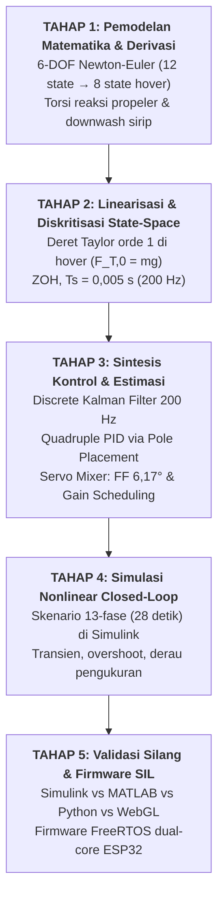
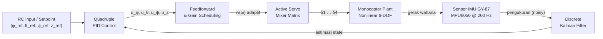

<div align="center">

# UAV Monocopter Control System

### Attitude & Altitude Control pada Unmanned Aerial Vehicle (UAV) Monocopter


Pemodelan 6-DOF Newton-Euler, Discrete Kalman Filter, Quadruple PID berbasis Pole Placement, dan validasi silang lintas platform (Simulink, MATLAB, Python, WebGL) untuk wahana monocopter tipe thrust-vectoring.

</div>

---

## Daftar Isi

1. [Ringkasan Proyek](#1-ringkasan-proyek)
2. [Kerangka Kerja Model-Based Design (MBD)](#2-kerangka-kerja-model-based-design-mbd-5-tahap)
3. [Arsitektur Kontrol & Algoritma Utama](#3-arsitektur-kontrol--algoritma-utama)
4. [Struktur Folder Repositori](#4-struktur-folder-repositori)
5. [Spesifikasi Hardware & BOM](#5-spesifikasi-hardware--bill-of-materials-bom)
6. [Panduan Penggunaan (Quick Start)](#6-panduan-penggunaan-quick-start)
7. [Hasil Simulasi & Validasi](#7-hasil-simulasi--validasi-lintas-platform)
8. [Sitasi Akademik](#8-sitasi-akademik)
9. [Lisensi](#9-lisensi)
10. [Ucapan Terima Kasih](#ucapan-terima-kasih)

---

## 1. Ringkasan Proyek

Pengembangan sistem kendali otonom pada UAV dengan konfigurasi **aktor tunggal (single-actuator)** merupakan salah satu tantangan teknik kontrol modern yang paling kompleks. Berbeda dengan multirotor konvensional yang memanfaatkan diferensiasi kecepatan putar antar-motor, monocopter tipe *thrust-vectoring* hanya menggunakan **satu propeler pusat** untuk gaya angkat. Kendali sikap (*attitude*) tiga sumbu dan kestabilan penerbangan sepenuhnya diserahkan pada defleksi **empat sirip kemudi (vane)** aktif yang bekerja di dalam aliran udara bawah (*downwash*).

Repositori ini mendokumentasikan kerangka rancang bangun, pemodelan dinamika 6-DOF Newton-Euler, sintesis algoritma estimasi dan kontrol, hingga validasi silang lintas platform untuk stabilisasi *attitude* (roll, pitch, yaw) dan *altitude*.

### Identitas Proyek

| Atribut | Keterangan |
|---|---|
| **Judul Proyek Akhir** | Attitude dan Altitude Control pada Unmanned Aerial Vehicle (UAV) Monocopter |
| **Penulis** | Faizahel Joasa Ariesta |
| **NIM** | 22/499164/SV/21287 |
| **Dosen Pembimbing** | Dr. Ir. Fahmizal, S.T., M.Sc., IPM., ASEAN Eng., SMIEEE. |
| **Program Studi** | Sarjana Terapan Teknologi Rekayasa Instrumentasi dan Kontrol |
| **Institusi** | Departemen Teknik Elektro dan Informatika, Sekolah Vokasi, Universitas Gadjah Mada (2026) |

### Tantangan Fisis: Tiga Instabilitas Ekstrem

1. **Instabilitas Pendulum Terbalik (*Inverted Pendulum*, $\Delta h > 0$)**
   Mayoritas massa (baterai Li-ion, mikrokontroler, rangka) berada di atas titik tangkap gaya dorong (rotor hub). Setiap simpangan sudut $\phi$ atau $\theta$ menghasilkan momen destabilisasi gravitasi yang memperbesar kemiringan:

   $$M_{\text{destab}} = mg\,\Delta h \sin\phi \approx mg\,\Delta h\,\phi$$

2. **Margin Statis Aerodinamis Rendah (*Low Static Margin*)**
   Perhitungan *Center of Pressure* (metode Barrowman) terhadap *Center of Gravity* menghasilkan Static Margin (SM) hanya sekitar **0,52 kaliber**, jauh di bawah ambang kestabilan pasif ($\ge 1{,}0$ kaliber). Wahana bersifat *statically unstable*.

3. **Gangguan Torsi Reaksi Propeler Tunggal**
   Sesuai Hukum III Newton, putaran motor menghasilkan torsi reaksi pada bodi:

   $$Q_{\text{reaksi}} = c_q F_T$$

   Tanpa rotor kedua berlawanan arah, bodi akan mengalami *yawing* tak terkendali.

> [!WARNING]
> Kombinasi instabilitas di atas membuat pengujian langsung pada prototipe fisik tanpa validasi *closed-loop* sangat berisiko. Galat sudut atau *latency* sensor sekecil apa pun dapat memicu osilasi divergen yang merusak wahana. Karena itu diperlukan kontrol aktif berfrekuensi tinggi (**200 Hz**).

### Lima Pilar Solusi

| # | Pilar | Deskripsi |
|---|---|---|
| 1 | **Pemodelan 6-DOF Newton-Euler Nonlinear** | Formulasi dinamika benda tegar 6-DOF dengan suku torsi reaksi propeler dan efektivitas sirip di bawah *downwash*. Reduksi 12 variabel keadaan menjadi 8 variabel terdekopling untuk *hover*: $x_8 = [\phi, \dot{\phi}, \theta, \dot{\theta}, \psi, \dot{\psi}, z, \dot{z}]^\top$ |
| 2 | **Discrete Kalman Filter (DKF) 200 Hz** | Estimator stokastik optimal dengan siklus Prediksi-Koreksi pada $T_s = 0{,}005$ s. Menapis derau IMU tanpa *phase lag*. |
| 3 | **Quadruple PID via Pole Placement Analitis** | Empat loop independen (Roll, Pitch, Yaw, Altitude) dengan *integrated error* ($x_I$). Gain $(K_p, K_i, K_d)$ diturunkan dengan menyamakan polinomial karakteristik target $P_{\text{target}}(s)$. |
| 4 | **Active Servo Mixer, Feedforward Anti-Torsi & Gain Scheduling** | Pemetaan momen virtual ke defleksi empat sirip $(\delta_1 \ldots \delta_4)$, bias *feedforward* $\delta_{\text{ff}} = 6{,}17^\circ$, dan *gain scheduling* kuadratik $w(\omega) = (\omega/\omega_{\text{hover}})^2$. |
| 5 | **Validasi Silang Lintas Platform** | Simulasi *closed-loop* skenario 13-fase selama 28 detik pada MATLAB/Simulink, skrip Python independen, dan simulator 3D WebGL (Three.js) untuk menghilangkan bias spesifik-platform. |

---

## 2. Kerangka Kerja Model-Based Design (MBD) 5-Tahap

*Model-Based Design* adalah metodologi standar industri penerbangan yang menempatkan pemodelan matematis berbasis fisika sebagai pusat siklus pengembangan. Risiko kegagalan fisik diisolasi di ranah simulasi sehingga iterasi penalaan, evaluasi ketahanan, dan verifikasi kode dapat dilakukan aman dan cepat sebelum menjadi firmware.



| Tahap | Nama | Uraian |
|:---:|---|---|
| **1** | Pemodelan Matematika & Derivasi Fisik | Menurunkan persamaan gerak 6-DOF Newton-Euler nonlinear. Untuk *hover*, model 12 state direduksi menjadi 8 state terdekopling, dengan mengeliminasi dinamika posisi dan kecepatan horizontal $(x, y, \dot{x}, \dot{y})$ yang tidak dikendalikan. |
| **2** | Linearisasi & Diskritisasi | Linearisasi deret Taylor orde pertama di titik hover nominal ($F_{T,0} = mg$, $\phi_0 = \theta_0 = 0$). Model $\dot{x} = Ax + Bu$ didiskritisasi dengan *Zero-Order Hold* pada $T_s = 0{,}005$ s menjadi $x[k+1] = A_d x[k] + B_d u[k]$. |
| **3** | Sintesis Kontrol & Estimasi | Merancang DKF untuk penapisan derau IMU dan empat loop PID independen dengan *pole placement* analitis pada model teraugmentasi $x_I$. |
| **4** | Simulasi Nonlinear Closed-Loop | Penerapan pengendali dan estimator pada plant nonlinear di Simulink. Skenario 13-fase 28 detik mencakup *take-off*, pelacakan *attitude*, penahanan ketinggian, dan *landing*. |
| **5** | Validasi Silang & Firmware SIL | Membandingkan luaran Simulink dengan skrip MATLAB, Python, dan WebGL 3D. Algoritma kemudian ditranslasikan ke firmware C++ FreeRTOS dual-core pada ESP32. |

---

## 3. Arsitektur Kontrol & Algoritma Utama

Sistem *closed-loop* mengintegrasikan seluruh subsistem dalam satu rantai pemrosesan real-time **200 Hz**. Data mentah IMU disaring oleh DKF menjadi estimasi sudut bebas derau, dibandingkan dengan setpoint RC untuk menghasilkan galat, diproses Quadruple PID menjadi momen virtual, lalu dipetakan Active Servo Mixer menjadi defleksi empat servo dan sinyal throttle ESC.



### 3.1 Discrete Kalman Filter (DKF) 200 Hz

DKF dirancang untuk mengatasi derau frekuensi tinggi akibat getaran motor dan percepatan sentripetal pada IMU, dengan vektor keadaan $x_8$:

$$x[k] = A_d x[k-1] + B_d u[k] + w[k], \quad w[k] \sim \mathcal{N}(0, Q)$$

$$y[k] = C_d x[k] + v[k], \quad v[k] \sim \mathcal{N}(0, R)$$

**Prediksi (*Time Update*)**

$$\hat{x}^-[k] = A_d \hat{x}[k-1] + B_d u[k]$$

$$P^-[k] = A_d P[k-1] A_d^\top + Q$$

**Koreksi (*Measurement Update*)**

$$K[k] = P^-[k] C_d^\top \left(C_d P^-[k] C_d^\top + R\right)^{-1}$$

$$\hat{x}[k] = \hat{x}^-[k] + K[k]\left(y[k] - C_d \hat{x}^-[k]\right)$$

$$P[k] = \left(I - K[k] C_d\right) P^-[k]$$

**Dampak kuantitatif:**

| Metrik | Sebelum | Sesudah | Perbaikan |
|---|:---:|:---:|:---:|
| RMSE sudut akselerometer (steady hover) | 8,11° | 2,54° | **68,7%** |
| Akumulasi gerakan jitter servo | 28.555,02° | 4.888,70° | **82,88%** |

Pemangkasan jitter secara signifikan mencegah *overheating* dan keausan mekanis aktuator.

### 3.2 Quadruple PID dengan Pole Placement Analitis

Empat loop PID independen dirancang dengan model teraugmentasi:

$$x_I[k+1] = x_I[k] + T_s\,(r[k] - y[k])$$

Polinomial karakteristik sistem teraugmentasi orde ketiga disamakan dengan polinomial target:

$$P_{\text{target}}(s) = \left(s^2 + 2\zeta\omega_n s + \omega_n^2\right)\left(s + \alpha\omega_n\right)$$

sehingga $K_p$, $K_i$, $K_d$ diperoleh secara analitis.

| Sumbu Kendali | $\omega_n$ (rad/s) | $\zeta$ | $K_p$ | $K_i$ | $K_d$ |
|---|:---:|:---:|:---:|:---:|:---:|
| Roll ($\phi$) | 12,0 | 0,707 | 1,0756 | 1,6126 | 0,1014 |
| Pitch ($\theta$) | 12,0 | 0,707 | 1,0756 | 1,6126 | 0,1014 |
| Yaw ($\psi$) | 8,0 | 0,707 | 0,6893 | 0,6500 | 0,0692 |
| Altitude ($z$) | 3,0 | 0,800 | 1,8349 | 0,4587 | 0,9786 |

### 3.3 Active Servo Mixer, Feedforward & Gain Scheduling

Modul ini mengonversi momen virtual $(u_\phi, u_\theta, u_\psi)$ menjadi defleksi empat sirip $(\delta_1, \delta_2, \delta_3, \delta_4)$. Untuk menghasilkan momen yaw anti-torsi murni tanpa mengganggu simetri roll dan pitch, keempat sirip diberi sudut bias seragam $\delta_{\text{ff}}$:

$$
\begin{bmatrix} \delta_1 \\ \delta_2 \\ \delta_3 \\ \delta_4 \end{bmatrix}
= \frac{1}{w(\omega)}\, M
\begin{bmatrix} u_\phi \\ u_\theta \\ u_\psi \end{bmatrix}
+
\begin{bmatrix} \delta_{\text{ff}} \\ \delta_{\text{ff}} \\ \delta_{\text{ff}} \\ \delta_{\text{ff}} \end{bmatrix}
$$

- **Kompensasi Feedforward Anti-Torsi:** $\delta_{\text{ff}} = 6{,}17^\circ$ (0,1077 rad), diturunkan secara teoritis untuk mengompensasi torsi reaksi nominal saat hover $Q_{\text{reaksi,hover}} = 0{,}02453$ N·m pada gaya dorong $F_{T,0} = 4{,}905$ N (massa acuan $m = 0{,}5$ kg). Kompensasi proaktif ini meniadakan akumulasi *windup* pada integrator PID Yaw.
- **Gain Scheduling Kuadratik:** Otoritas kemudi sirip diadaptasi terhadap kecepatan putar motor melalui

  $$w(\omega) = \left(\frac{\omega}{\omega_{\text{hover}}}\right)^2$$

  Saat $\omega < \omega_{\text{hover}}$, penguatan sirip dinaikkan otomatis untuk mengompensasi turunnya tekanan dinamik *downwash*.

### 3.4 Arsitektur Firmware (FreeRTOS ESP32)

Firmware berjalan pada **ESP32 DevKit V1** dengan FreeRTOS dual-core:

| Core | Tugas | Cakupan |
|:---:|---|---|
| **Core 0** | Komunikasi & Web Server | Protokol WebSocket/JSON untuk telemetri, serta Web Server antarmuka pengguna dari memori flash LittleFS. |
| **Core 1** | Kontrol Real-Time 200 Hz | Pembacaan I²C IMU GY-87, eksekusi DKF, kalkulasi Quadruple PID, dan pembaruan PWM servo/ESC via perifer LEDC secara deterministik. |

### 3.5 Interactive 3D WebGL Simulator

Simulator 3D interaktif berbasis JavaScript dan **Three.js (WebGL)** disediakan untuk visualisasi kualitatif. Simulator menerima telemetri real-time via WebSocket atau menjalankan model dinamika internal di peramban untuk menampilkan animasi gerak 3D wahana, defleksi empat servo, dan grafik telemetri dinamis.

---

## 4. Struktur Folder Repositori

Repositori diorganisasikan secara modular untuk memisahkan skrip pemodelan, simulasi Simulink, validasi Python, firmware mikrokontroler, dan simulator WebGL.

```text
uav-monocopter-control/
├── simulink/
│   ├── monocopter_control_system.slx   # Model Simulink closed-loop nonlinier utama
│   └── README.md                       # Petunjuk konfigurasi solver Simulink
├── matlab/
│   ├── monocopter_params.m             # Derivasi parameter fisik & gain PID
│   ├── dkf_design.m                    # Sintesis & simulasi Discrete Kalman Filter
│   └── step_response_analysis.m        # Analisis domain frekuensi & Bode plot
├── python/
│   ├── main_simulation.py              # Simulasi 13-fase berbasis Python
│   ├── monocopter_dynamics.py          # Class model dinamika 6-DOF Newton-Euler
│   └── requirements.txt                # Dependensi (numpy, scipy, matplotlib)
├── firmware_esp32/
│   ├── src/
│   │   ├── main.cpp                    # Firmware FreeRTOS dual-core ESP32
│   │   ├── dkf_filter.cpp              # Implementasi C++ Discrete Kalman Filter
│   │   └── pid_controller.cpp          # Implementasi C++ Quadruple PID & Servo Mixer
│   ├── data/                           # Web dashboard untuk diunggah ke LittleFS
│   │   ├── index.html                  # Antarmuka dasbor pemantauan utama
│   │   └── app.js                      # WebSocket & grafik telemetri
│   └── platformio.ini                  # Konfigurasi PlatformIO
├── webgl_simulator/
│   ├── index.html                      # Halaman utama simulator 3D WebGL
│   ├── js/
│   │   ├── simulator.js                # Engine Three.js & fisika WebGL
│   │   └── telemetry_chart.js          # Grafik telemetri real-time
│   └── css/
│       └── style.css                   # Tata letak antarmuka simulator
├── cad_design/
│   ├── monocopter_assembly.step        # Model CAD 3D assembly wahana acuan
│   └── STL/                            # Berkas STL siap cetak 3D
└── docs/
    ├── BOM_Hardware.pdf                # Bill of Materials & spesifikasi komponen
    └── Schematic_Wiring.pdf            # Skematik pengabelan & distribusi daya ESP32
```

---

## 5. Spesifikasi Hardware & Bill of Materials (BOM)

Pemilihan komponen didasarkan pada rasio gaya dorong terhadap berat (*Thrust-to-Weight Ratio*, **TWR ≥ 1,5**) serta kemampuan pemrosesan real-time mikrokontroler untuk menjamin siklus kendali 200 Hz tanpa *latency*.

| Kategori | Komponen | Spesifikasi Kunci | Jumlah | Fungsi Utama |
|---|---|---|:---:|---|
| Mikrokontroler | ESP32 DevKit V1 | Dual-Core LX6 240 MHz, 520 KB SRAM, Wi-Fi/BT | 1 | FreeRTOS, DKF, PID, Servo Mixer, WebServer |
| Sensor Attitude | Modul GY-87 (10-DOF) | MPU6050 (IMU) + HMC5883L (Mag) + BMP180 (Baro) | 1 | Laju sudut giroskop & percepatan akselerometer |
| Aktuator Utama | Motor BLDC | Brushless outrunner, nominal hover $F_{T,0} = 4{,}905$ N | 1 | Gaya dorong vertikal murni ($F_T$) |
| Penggerak Motor | ESC | 30A–40A, input PWM/OneShot | 1 | Mengatur kecepatan putar motor ($\omega$) |
| Aktuator Kemudi | Digital Metal Gear Servo | Kecepatan ≤ 0,10 s/60°, torsi ≥ 1,8 kg·cm | 4 | Defleksi empat sirip ($\delta_1 \ldots \delta_4$) |
| Catu Daya | Baterai LiPo / Li-ion | 3S (11,1–12,6 V), arus rilis tinggi | 1 | Daya motor, servo, dan elektronika |
| Struktur Rangka | Rangka cetak 3D | PLA / PETG, tinggi 320 mm, $m = 0{,}5$ kg | 1 set | Bodi silinder aerodinamis, nose cone, dudukan sirip |

**Justifikasi komponen utama:**

- **ESP32 DevKit V1:** Arsitektur dual-core memisahkan secara deterministik tugas kendali 200 Hz (Core 1) dari komunikasi Wi-Fi/WebSocket (Core 0), sehingga tidak ada *jitter* pada loop tertutup.
- **Modul GY-87:** Mengintegrasikan IMU 6-axis MPU6050 berkecepatan tinggi pada bus I²C (400 kHz Fast Mode), ideal untuk akuisisi sudut *attitude* dan laju putar bodi.

---

## 6. Panduan Penggunaan (Quick Start)

Panduan ini menjamin keterulangan (*reproducibility*) hasil simulasi dan kompilasi kode.

### 6.1 Simulasi MATLAB/Simulink

**Prasyarat:** MATLAB R2021b atau lebih baru.

1. Buka MATLAB dan arahkan *Current Folder* ke direktori `matlab/`.
2. Jalankan skrip inisialisasi parameter fisika dan gain PID:

   ```matlab
   run('matlab/monocopter_params.m')
   ```

3. Buka dan jalankan model `simulink/monocopter_control_system.slx`.

### 6.2 Validasi Python

**Prasyarat:** Python 3.8+.

1. Masuk ke direktori `python/` dan instal dependensi:

   ```bash
   cd python
   pip install -r requirements.txt
   ```

2. Jalankan simulasi penerbangan 13-fase:

   ```bash
   python main_simulation.py
   ```

3. Skrip menampilkan plot perbandingan respons transien dan menyimpan log numerik.

### 6.3 Deploy Firmware ESP32 & LittleFS

**Prasyarat:** VS Code dengan ekstensi PlatformIO.

1. Buka direktori `firmware_esp32/` di VS Code.
2. Hubungkan ESP32 DevKit V1 ke komputer via USB.
3. Unggah data dasbor web ke flash LittleFS:

   ```bash
   platformio run --target uploadfs
   ```

4. Kompilasi dan unggah firmware utama:

   ```bash
   platformio run --target upload
   ```

5. Hubungkan Wi-Fi komputer/ponsel ke Access Point **`Monocopter-AP`** (IP default: `192.168.4.1`).

### 6.4 Simulator WebGL 3D

1. Masuk ke direktori `webgl_simulator/`.
2. Buka `index.html` di peramban modern (Chrome, Firefox, atau Edge).
3. Pilih moda:
   - **Offline Simulation**: memutar skenario uji 28 detik.
   - **WebSocket Live**: terhubung real-time dengan firmware ESP32.

---

## 7. Hasil Simulasi & Validasi Lintas Platform

Algoritma divalidasi melalui simulasi nonlinear *closed-loop* skenario penerbangan penuh 13-fase selama 28 detik untuk mengeliminasi bias spesifik-platform.

### 7.1 Performa Pelacakan Lintasan 13-Fase (28 Detik)

- **Respons langkah terisolasi (*isolated step response*):** overshoot di seluruh sumbu < **0,80%**.
- **Skenario penerbangan penuh** (dengan derau sensor dan gangguan torsi reaksi):

| Sumbu | Overshoot |
|---|:---:|
| Roll ($\phi$) | 4,6% |
| Pitch ($\theta$) | 7,0% |
| Yaw ($\psi$) | 1,0% |
| Altitude ($z$) | 0,2% |

### 7.2 Validasi Silang Kuantitatif (MATLAB vs Python vs WebGL)

Galat RMS terhadap acuan Simulink:

| Sumbu Terbang | MATLAB Script | Python Script | WebGL Simulator |
|---|:---:|:---:|:---:|
| Roll ($\phi$) | 0,12% | 1,45% | 0,88% |
| Pitch ($\theta$) | 0,15% | 2,21% | 1,02% |
| Yaw ($\psi$) | 0,08% | 1,12% | 0,65% |
| Altitude ($z$) | 0,02% | 0,48% | 0,31% |

> [!NOTE]
> Galat RMS konsisten di bawah 2,00% pada hampir seluruh sumbu. Pengecualian: sumbu Pitch pada skrip Python (2,21%) akibat perbedaan algoritma *ODE solver*. Hasil ini menunjukkan integritas numerik dan portabilitas algoritma yang tinggi.

### 7.3 Analisis Ketahanan Domain Frekuensi (Bode Plot)

Analisis respons frekuensi *open-loop* menunjukkan seluruh kanal kendali memiliki **Phase Margin (PM) positif**, sehingga kestabilan fasa *closed-loop* terjamin. Namun, ditemukan **Gain Margin (GM) negatif** pada sumbu *attitude*.

> [!IMPORTANT]
> Temuan GM negatif merupakan catatan kritis untuk pengembangan hardware fisik. Diperlukan pembatas gain eksternal (*gain limiter*) atau *notch filter* untuk mencegah instabilitas akibat fleksibilitas struktur mekanis.

### 7.4 Pembuktian Hipotesis (Ablation Study)

| Hipotesis | Temuan |
|---|---|
| **H1: Kompensasi Anti-Torsi Yaw** | Bias *feedforward* 6,17° meniadakan galat offset kondisi tunak sumbu yaw saat hover dan mereduksi beban koreksi integral PID Yaw hingga **100%**. |
| **H2: Keandalan Estimasi DKF** | DKF memangkas derau IMU sebesar **68,7%** dan akumulasi jitter servo sebesar **82,88%** tanpa penundaan transien yang merusak kestabilan. |
| **H3: Portabilitas Lintas Platform** | Konsistensi luaran dengan galat RMS **< 2,00%** membuktikan formulasi algoritma bebas dari ketergantungan library spesifik platform. |

---

## 8. Sitasi Akademik

Jika Anda menggunakan repositori, model simulasi, atau kode sumber ini dalam riset akademis, mohon sitasi dengan format BibTeX berikut:

```bibtex
@thesis{Ariesta2026Monocopter,
  author     = {Ariesta, Faizahel Joasa},
  title      = {Attitude dan Altitude Control pada Unmanned Aerial Vehicle (UAV) Monocopter},
  school     = {Universitas Gadjah Mada},
  department = {Departemen Teknik Elektro dan Informatika, Sekolah Vokasi},
  program    = {Program Studi Sarjana Terapan Teknologi Rekayasa Instrumentasi dan Kontrol},
  year       = {2026},
  type       = {Proyek Akhir},
  address    = {Yogyakarta, Indonesia},
  note       = {Dosen Pembimbing: Dr. Ir. Fahmizal, S.T., M.Sc., IPM., ASEAN Eng., SMIEEE.}
}
```

---

## 9. Lisensi

Perangkat lunak dan dokumentasi dalam repositori ini didistribusikan di bawah **MIT License**.

```text
MIT License

Copyright (c) 2026 Faizahel Joasa Ariesta / Universitas Gadjah Mada

Permission is hereby granted, free of charge, to any person obtaining a copy
of this software and associated documentation files (the "Software"), to deal
in the Software without restriction, including without limitation the rights
to use, copy, modify, merge, publish, distribute, sublicense, and/or sell
copies of the Software, and to permit persons to whom the Software is
furnished to do so, subject to the following conditions:

The above copyright notice and this permission notice shall be included in all
copies or substantial portions of the Software.

THE SOFTWARE IS PROVIDED "AS IS", WITHOUT WARRANTY OF ANY KIND, EXPRESS OR
IMPLIED, INCLUDING BUT NOT LIMITED TO THE WARRANTIES OF MERCHANTABILITY,
FITNESS FOR A PARTICULAR PURPOSE AND NONINFRINGEMENT. IN NO EVENT SHALL THE
AUTHORS OR COPYRIGHT HOLDERS BE LIABLE FOR ANY CLAIM, DAMAGES OR OTHER
LIABILITY, WHETHER IN AN ACTION OF CONTRACT, TORT OR OTHERWISE, ARISING FROM,
OUT OF OR IN CONNECTION WITH THE SOFTWARE OR THE USE OR OTHER DEALINGS IN THE
SOFTWARE.
```

---

## Ucapan Terima Kasih

Penulis menyampaikan apresiasi tertinggi kepada **Laboratorium Otomasi dan 3D Print, Sekolah Vokasi Universitas Gadjah Mada** atas penyediaan fasilitas riset dan komputasi, serta kepada Dosen Pembimbing **Dr. Ir. Fahmizal, S.T., M.Sc., IPM., ASEAN Eng., SMIEEE.** atas bimbingan ilmiah, masukan teknis, dan dedikasi berkelanjutan selama penyelesaian proyek akhir ini.